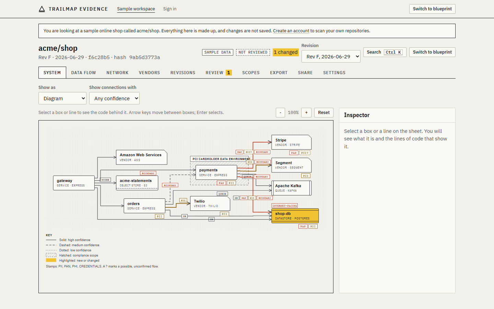

# Trailmap Evidence

Architecture evidence drawn from your code. Trailmap reads your repositories and produces the system, data-flow and network diagrams that PCI DSS, SOC 2 and DORA reviews ask for, with the file and line behind every box and arrow. A pull request check tells you when a change adds a vendor, exposes a datastore or moves regulated data across your scope boundary.



Trailmap supports an assessment. It does not certify anything and makes no claim that you are compliant: the requirement notes in every export say what a person must still verify.

## Try it in two minutes, with no accounts

Everything runs locally against an embedded Postgres and a mocked GitHub. No credentials, no Docker.

```sh
npm ci
npm run build
TRAILMAP_LOCAL=1 npm run dev --workspace=@trailmap/web
```

Open <http://localhost:3000/demo> for the sample workspace (no sign-in), or <http://localhost:3000/sign-in> and pick a sample user to see the full product: dashboard, scan, scope editor, export, share links and the pull request check. Local mode refuses to start in production unless you also set `TRAILMAP_LOCAL_SANDBOX=i-understand-this-uses-no-real-data`, and its data is lost on restart.

## What you get

| | |
|---|---|
| **Three sheets** | System architecture, data flow, and network and exposure, drawn on survey-sheet paper with a title block that carries the commit, date, reviewer and a hash of the data. |
| **Evidence** | Select any box or line to see the code that proves it. Line style shows confidence (solid, dashed, dotted). Data classes (PAN, PII, PHI, credentials) are stamped on connections; a `?` means possible, not confirmed in code. |
| **Vendors** | Third-party inventory with the data classes that reach each vendor, plus purpose, region and DPA status you record. CSV, and a DORA register-of-information assist. |
| **Scopes** | Draw your compliance scope by clicking, shift-clicking or lassoing boxes. Hatched on the sheet; crossings are flagged. |
| **Drift** | A check run and one comment on each pull request. Acknowledge accepted risk in the app or with `/trailmap ack`; the check turns green and the decision is recorded against the exact graph. |
| **Revisions** | Every scan is a revision (Rev A, B, C...). Time travel to any date. |
| **Auditor export** | PDF (title block, sheets, requirement notes, vendors, revision log, evidence appendix), SVG, JSON, CSV or a zip with a hash manifest. Every export is recorded with the hash of the file. |
| **Share links** | Read-only, optional password, expiry, a watermark naming the recipient, an access log, instant revoke. |

## Command line

The scanner runs locally. Nothing is uploaded unless you pass `--upload`.

```sh
npx trailmap scan .                       # write the architecture graph
npx trailmap vendors .                    # third-party inventory with evidence
npx trailmap evidence . --framework pci   # local evidence pack (pci, soc2 or dora)
npx trailmap check . --base origin/main   # drift against a git ref, no account needed
npx trailmap check . --remote             # drift against the baseline stored in Trailmap
```

GitHub Action (`action.yml` in this repository):

```yaml
- uses: actions/checkout@v4
  with: { fetch-depth: 0 }
- uses: ./   # or your fork of this action
  with:
    mode: check
    base-ref: origin/main
```

MCP server for coding agents: see `mcp.example.json`. Tools include `get_compliance_scope`, `get_data_flows` and `check_change` alongside the graph tools.

Repository policy lives in `.trailmap.yml`:

```yaml
version: 1
on_drift: failure          # neutral (default) or failure
frameworks: [pci-dss, soc2]
scopes:
  - name: Cardholder data environment
    nodes: ["service:services/payments", "db:postgres"]
ignore: ["vendor:datadog"]  # accepted risk, by node id or finding key
rules:
  low_confidence_in_scope: false
```

## Self-hosting

You need a Supabase project (Postgres, auth) and a GitHub App.

1. **Database.** Apply `supabase/migrations/*.sql` in order. Row-level security is on for every table.
2. **Environment.** Copy `apps/web/.env.example` and `apps/worker/.env.example`.
3. **GitHub App.** Create one with:
   - Repository permissions: **Contents: read**, **Metadata: read**, **Checks: read and write**, **Pull requests: read and write**, **Issues: write** (pull request comments are issue comments).
   - Subscribe to events: **push**, **pull_request**, **issue_comment**, **installation**, **installation_repositories**, **check_run**.
   - Webhook URL `https://<your-app>/api/webhooks/github` and a webhook secret (`GITHUB_WEBHOOK_SECRET`). Requests with a missing or wrong signature are rejected, and the route refuses to run at all if the secret is unset.
   - Set a callback URL to `https://<your-app>/auth/callback` and enable "Request user authorization (OAuth) during installation" if you want GitHub sign-in.
4. **Web app.** `npm run build && npm run start --workspace=@trailmap/web`.
5. **Worker.** `docker compose up worker` (or `npm run start --workspace=@trailmap/worker`). Routes only enqueue work; the worker is the only thing that clones and scans. It claims jobs atomically, clones to a temporary directory and deletes it in a `finally` block.

Only the graph is stored. See `SECURITY.md` for exactly what is kept.

## Repository layout

```
packages/scanner      source and infrastructure code -> deterministic graph
packages/graph        schema, hashing, diff, scope, drift rules, policy, vendors, overrides
packages/pipeline     the one executor: clone, scan, snapshot, diff, drift, check run
packages/frameworks   PCI DSS, SOC 2 and DORA notes as data
packages/sheets       layout, SVG and PDF renderers for the three sheets
packages/ui           the Survey sheet design system (tokens and components)
packages/cli, mcp, integrations, localdb
apps/web              Next.js app: workspace, exports, share links, API
apps/worker           job runner
supabase/migrations   schema and row-level security
e2e/                  Playwright tests
```

Read `ARCHITECTURE.md` for how the pieces fit, `docs/accuracy.md` for what the scanner gets right and where it does not, and `docs/performance.md` for measurements.

## Development

```sh
npm ci
npm run build && npm run check-types && npm run lint
npm test                 # unit and integration; database tests run on in-process Postgres
npm run test:coverage    # gates: scanner, pipeline and web lib at 80% lines
npm run eval             # scanner precision/recall gate, writes docs/accuracy.md
npm run e2e              # needs a prior build; runs the app in local mode in a real browser
```

## Known limitations

- Static analysis cannot resolve URLs built at runtime, service discovery through a registry, infrastructure modules from other repositories or generated code. Review `dashed` and `dotted` lines, and use decisions (confirm, hide, add) where the scanner is wrong; each is recorded with a reason.
- The scanner's accuracy figures are measured on fixtures written alongside it; see `docs/accuracy.md` for the caveat.
- Code cannot show who has access, how staff are trained or whether a policy is followed. Those parts of any framework stay with a person.
- The Drata, Vanta and webhook delivery code (`packages/integrations`) is generic (bearer token, OAuth client credentials, signed webhook), tested against mocked servers, and not yet called from any route. It is not a certified partner integration.
- API-key rate limiting is per instance.
